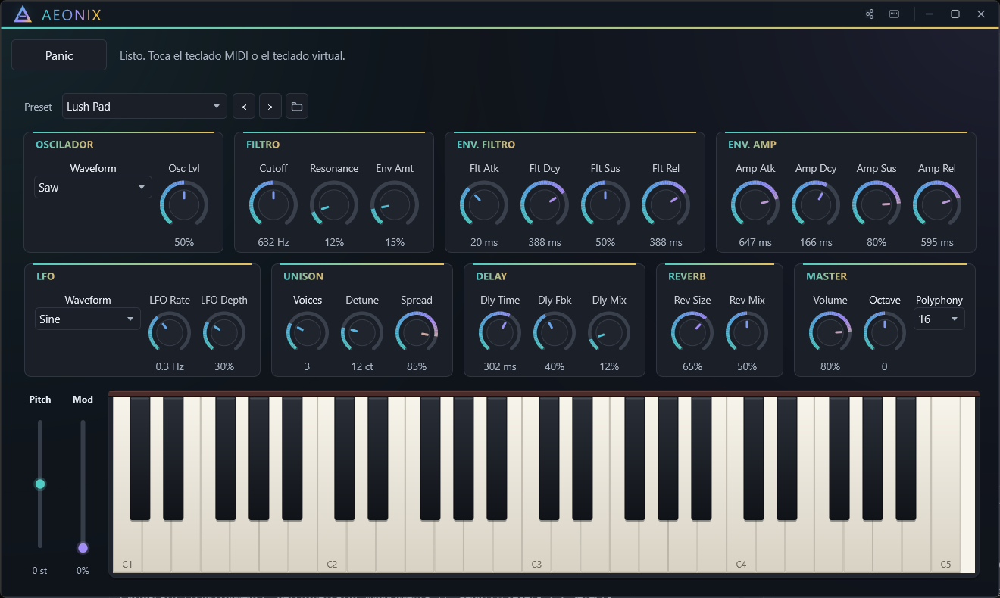

# AEONIX

[](https://github.com/amareca/aeonix-synth/releases/latest)
[](LICENSE)
[](#download-windows)
[](#build-on-windows)
[](#build-on-windows)
[](#features)

English · [Español](#español)

**A free, open-source standalone subtractive synthesizer for Windows.**



*Main surface with extra-large text. AEONIX 0.1.0, PRO build.*

AEONIX is a desktop instrument for Windows 10 and 11 (64-bit), built with C++20 and
JUCE 8. It is designed for cinematic pads, atmospheric plucks and experimental sound
design, with the whole signal path visible on a single screen.

- **Free and open source** — AGPL-3.0, full source available.
- **Standalone application** — not a VST/VST3 plugin yet.
- **64 sound-design controls** — oscillator, filter, envelopes, LFO, unison, delay,
  reverb and master.

**Website:** <https://amareca.github.io/aeonix-synth/> ·
**Download:** [GitHub Releases](https://github.com/amareca/aeonix-synth/releases/latest)

## Features

- Subtractive synthesis with an oscillator, filter, envelopes and LFO.
- Unison with stereo spread, delay and reverb.
- Preset manager with factory and user presets, search, filters, favourites and
  recents.
- MIDI input, on-screen keyboard, pitch and modulation wheels.
- Four visual themes: Holo Accents, Holo Glass, Holo Minimal and Prototype.
- Accessibility: Normal / Large / Extra large text, automatic detection by screen
  size and improved contrast.
- English and Spanish interface.

## Requirements

- Windows 10 or Windows 11, 64-bit.
- No installer and no Visual C++ runtime required: unzip the release and run
  `AEONIX.exe`.
- Build: Visual Studio 2022 Build Tools with the C++ workload, CMake 3.24+ and
  Windows PowerShell 5.1.

## Download (Windows)

Only Windows 10/11, 64-bit, is supported in 0.1.0.

1. Download `AEONIX-0.1.0-win64.zip` from
   [Releases](https://github.com/amareca/aeonix-synth/releases).
2. Unzip it and run `AEONIX.exe`.

- The executable **is not code-signed**, so SmartScreen may warn the first time.
  Check the SHA-256 published in the release and use
  "More info → Run anyway".
- User data lives in `%APPDATA%\Aeonix` and `Documents\Aeonix\Presets`.

## Build on Windows

With Visual Studio 2022 Build Tools (C++ workload) and CMake 3.24+ installed:

```powershell
git submodule update --init --recursive   # fetches JUCE
.\dev.ps1 build
```

Or use CMake directly:

```powershell
cmake --preset dev
cmake --build --preset release
```

The development build is written to
`build/Aeonix_artefacts/Release/AEONIX-dev.exe`; the PRO build goes to
`build-pro/Aeonix_artefacts/Release/AEONIX.exe`.

## Development

`dev.ps1` is the single entry point:

| Command | Purpose |
|---|---|
| `.\dev.ps1 doctor` | Environment diagnostics |
| `.\dev.ps1 build` | Release build (`-Configuration Debug` for Debug) |
| `.\dev.ps1 test` | CTest suite (`-Tag engine`, `-Changed`, `-Failed`, `-Build`) |
| `.\dev.ps1 verify` | Configure + build + tests |
| `.\dev.ps1 ui` | F11/F12 matrix for themes, text sizes and languages (`-Quick` to iterate) |
| `.\dev.ps1 presets` | Preset manager smoke test |
| `.\dev.ps1 captures` | Screenshot summary; `-Clean`, `-Legacy` or `-Open` |

## Verify

```powershell
.\dev.ps1 verify
```

If PowerShell blocks the scripts:

```powershell
powershell -ExecutionPolicy Bypass -File .\dev.ps1 verify
```

## Status

AEONIX 0.1.0 is an early release for Windows 10/11 (64-bit). It is a standalone
application; VST3 support is planned but not available yet. Release history and
the changes prepared for 0.2.0 are tracked in [`CHANGELOG.md`](CHANGELOG.md).

## Support

Bugs and feature requests go to
[Issues](https://github.com/amareca/aeonix-synth/issues). Include the AEONIX version,
your Windows version and the steps to reproduce. For build problems, paste the
output of `.\dev.ps1 doctor`.

## Contributing

See [`CONTRIBUTING.md`](CONTRIBUTING.md) for requirements, commands and the
branch flow.

## License

AEONIX is distributed under the **GNU Affero General Public License v3.0**
(AGPL-3.0). The full text is in [`LICENSE`](LICENSE).

Copyright (C) 2026 AEONIX contributors.

JUCE 8.0.15 is used under AGPLv3 and Catch2 under BSL-1.0; see
[`THIRD_PARTY_NOTICES.md`](THIRD_PARTY_NOTICES.md). Binary releases must offer the
corresponding source code.

## Español

**Sintetizador sustractivo standalone, gratuito y open source para Windows.**

AEONIX es un instrumento de escritorio para Windows 10 y 11 de 64 bits, escrito en
C++20 con JUCE 8, pensado para pads cinematográficos, plucks atmosféricos y diseño
sonoro experimental.

- **Web en español:** <https://amareca.github.io/aeonix-synth/es/>
- **Descarga:** [GitHub Releases](https://github.com/amareca/aeonix-synth/releases/latest)
  (`AEONIX-0.1.0-win64.zip`, Windows 10/11 de 64 bits, sin runtime adicional).
- **Código:** <https://github.com/amareca/aeonix-synth>

### Compilar (Windows)

Requisitos: Visual Studio 2022 Build Tools (C++), CMake 3.24+ y Windows
PowerShell 5.1.

```powershell
git submodule update --init --recursive
.\dev.ps1 build
```
